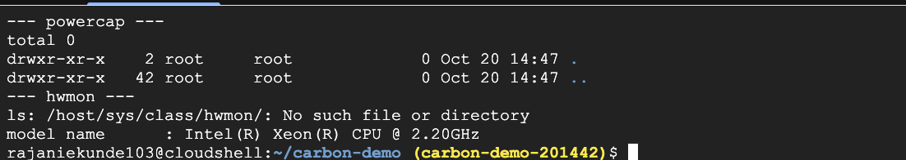
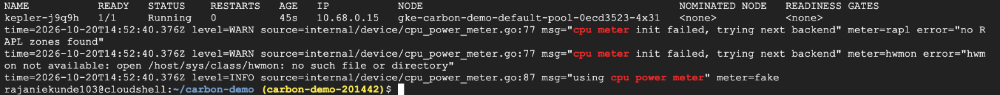
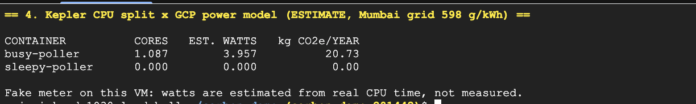
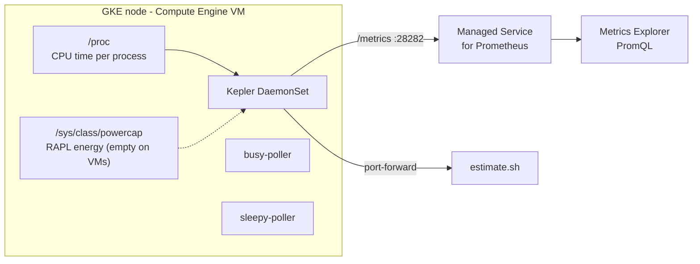

# Your Container Has a Carbon Bill

**Measuring Docker workloads on GKE with Kepler.** This is the demo for my talk at **CNCG Pune (21 October 2026)**.

Every container burns power, so every container has a carbon cost. Nobody sends us that invoice.
This repo deploys [Kepler](https://github.com/sustainable-computing-io/kepler) on Google Kubernetes Engine,
runs two containers that do the same job in different ways, and turns their CPU usage into watts and
grams of CO₂e.

It also shows the part most demos skip: **on a cloud VM, there is usually no power meter to read.**

---

## What the demo shows

| Scene | What you see |
|---|---|
| 1. Power meter check | The GKE node has no RAPL (`/sys/class/powercap` is empty) and no hwmon |
| 2. Kepler installs | Kepler tries `rapl`, then `hwmon`, then falls back to `fake`, and logs it |
| 3. Same job, two containers | `busy-poller` uses ~1 core, `sleepy-poller` ~0, for the same work |
| 4. Watts to carbon | Kepler's real CPU split × a published GCP power model → watts and kg CO₂e/year |

### Results from a real run (GKE, `asia-south1-a`, e2-standard-4, Kepler v0.12.0)







```
CONTAINER          CORES   EST. WATTS   kg CO2e/YEAR
busy-poller        1.087        3.957          20.73
sleepy-poller      0.000        0.000           0.00
```

One tight polling loop ≈ one core ≈ **~4 W, around 21 kg CO₂e a year on the Mumbai grid**.
Fix the loop and the carbon bill drops with it.

---

## How it works



1. **Kepler** reads the CPU's energy counter (RAPL) when one exists, splits node energy into idle and
   active, and shares the active part between containers by their **CPU time** from `/proc`.
2. **On GKE**, the node is a VM. The hypervisor doesn't expose RAPL or hwmon, so Kepler falls back to its
   `fake` meter. Its own watts are then synthetic (microwatts), but the **CPU attribution is still real**.
3. **The estimate** uses that real CPU time with the
   [Cloud Carbon Footprint](https://www.cloudcarbonfootprint.org/) methodology's GCP averages:

   ```
   est. watts   = CPU cores × (4.98 W − 1.34 W)        # max − min per vCPU, GCP average
   kg CO2e/year = watts × 8760 h ÷ 1000 × 598 g/kWh ÷ 1000
   ```

   598 gCO₂e/kWh is the grid carbon intensity of `asia-south1` (Mumbai) from
   [Google Cloud's region carbon data](https://cloud.google.com/sustainability/region-carbon) (2025).

> **Estimated, not measured.** Use these numbers to compare workloads and spot waste, not for
> sustainability reporting. On bare metal, where RAPL exists, use Kepler's own energy metrics instead
> (see [`queries/metrics-explorer.promql`](queries/metrics-explorer.promql)).

---

## Quick start

### Prerequisites

- A Google Cloud project with billing enabled
- `gcloud`, `kubectl`, and `helm` 3.8+ (all pre-installed in [Cloud Shell](https://shell.cloud.google.com))

### Run it

```bash
git clone https://github.com/rajani103/kepler-gke-carbon-demo.git
cd kepler-gke-carbon-demo

gcloud config set project YOUR_PROJECT_ID
source scripts/00-env.sh           # project, zone, cluster name, grid intensity

./scripts/01-create-cluster.sh     # 1-node GKE Standard + Managed Prometheus (~5-8 min)
./scripts/02-check-power-meter.sh  # is there RAPL / hwmon on the node?
./scripts/03-install-kepler.sh     # Helm install, shows which meter Kepler picked
./scripts/04-deploy-workloads.sh   # busy-poller vs sleepy-poller
./scripts/estimate.sh              # estimated watts and kg CO2e/year per container
```

For a live or recorded demo, run the whole story one scene per keypress:

```bash
./scripts/demo.sh
```

Let the workloads run for a few minutes before scene 4, so there is CPU history to sample.

### Clean up

```bash
./scripts/99-cleanup.sh            # deletes the namespace, Kepler, and the cluster
```

---

## Repository layout

```
.
├── manifests/
│   ├── kepler-values.yaml      # Helm values: meter order rapl → hwmon → fake
│   ├── podmonitoring.yaml      # Managed Prometheus scrape config for Kepler
│   └── workloads.yaml          # busy-poller vs sleepy-poller (python:3.12-slim)
├── queries/
│   └── metrics-explorer.promql # PromQL for Cloud Monitoring (estimate + measured)
├── scripts/
│   ├── 00-env.sh               # shared settings
│   ├── 01-create-cluster.sh
│   ├── 02-check-power-meter.sh
│   ├── 03-install-kepler.sh
│   ├── 04-deploy-workloads.sh
│   ├── estimate.sh             # CPU split × GCP power model
│   ├── demo.sh                 # scene-by-scene run of show
│   └── 99-cleanup.sh
└── docs/images/                # screenshots from a real run
```

## Configuration

| Variable | Default | Meaning |
|---|---|---|
| `ZONE` | `asia-south1-a` | GKE zone |
| `GRID_INTENSITY` | `598` | gCO₂e per kWh for your region. Look yours up in [region carbon data](https://cloud.google.com/sustainability/region-carbon) |
| `MIN_W` / `MAX_W` | `1.34` / `4.98` | Watts per vCPU at 0% / 100% (Cloud Carbon Footprint, GCP average) |
| `WINDOW` | `30` | Seconds between the two samples in `estimate.sh` |

## Notes and caveats

- **GKE Standard, not Autopilot.** Kepler runs privileged and mounts the host's `/proc` and `/sys`.
- **Kepler v0.10+** (the rewrite) dropped eBPF and needs only read-only `/proc` and `/sys`. Metric names
  changed from earlier versions.
- **Zones overlap.** `package` includes `core`; always filter to one zone, never sum them.
- **CPU only.** Kepler's CPU energy excludes DRAM (unless you use that zone), fans, NICs and PSU losses.
- **Sampling.** Kepler samples every 5 s, so short windows can show slightly more than 1 core for a
  pod limited to 1 CPU.


## Author

**Rajani Ekunde**: Senior Site Reliability Engineer · Docker Captain · Google Developer Expert, Google Cloud · Women Techmakers Ambassador

[LinkedIn](https://www.linkedin.com/in/rajani103/) · [X](https://x.com/misalpavv) · [GitHub](https://github.com/rajani103)

## License

[Apache 2.0](LICENSE)
